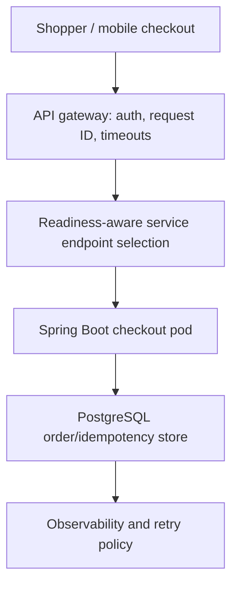

# Episode 013 — The Checkout Routing Failure — API Gateway, Load Balancing & Service Discovery

**Architecture in Motion · Reconstructed edition · Original scenario, not a measured customer incident**

## Hook: the customer sees the failure first

During a flash-sale deployment, customers see intermittent 502/503 errors and a checkout spinner; retries can submit an order twice.

## Request path and root cause

Shopper / mobile checkout → API gateway: auth, request ID, timeouts → Readiness-aware service endpoint selection → Spring Boot checkout pod → PostgreSQL order/idempotency store → Observability and retry policy

The gateway forwards requests to a terminating checkout pod because service discovery still contains its endpoint, or readiness is declared before the application can serve traffic.

## Solution: design for correctness before speed

Use readiness probes, preStop drain, graceful shutdown, bounded gateway retries only for safe operations, and durable idempotency keys for order placement. Propagate trace IDs and measure 502/503 rates.

## Trade-offs, scaling and performance

A retry is not safe merely because the gateway timed out: the upstream may have committed the order.

Scale independently where justified; monitor tail latency, error budgets, retry rates, event or endpoint freshness, and business correctness. All timing illustrations are conceptual, not benchmark results.

## Failure handling and resilience

Apply explicit timeout budgets; retry only when semantics are safe; protect payment and order side effects with durable idempotency; use structured logs, traces, alerting and reconciliation.

## Security

Authenticate at gateway and service boundaries, authorize per customer/order, validate signed events where applicable, restrict infrastructure credentials, avoid PII in traces and logs, and use TLS in transit.

## Architecture diagram



## Runnable Java 21 teaching example

```java
package demo;
import java.util.*;
import java.util.concurrent.*;
public class RoutingDemo {
  record Pod(String name, boolean ready, boolean terminating) {}
  static Optional<Pod> choose(List<Pod> pods) {
    return pods.stream().filter(p -> p.ready() && !p.terminating()).findFirst();
  }
  public static void main(String[] args) {
    var pods = List.of(new Pod("checkout-a", true, true), new Pod("checkout-b", true, false));
    var selected = choose(pods).orElseThrow();
    if (!selected.name().equals("checkout-b")) throw new AssertionError("Unsafe route");
    System.out.println("PASS: routed to " + selected.name());
  }
}
```

## PostgreSQL teaching schema

```sql
-- PostgreSQL: durable order idempotency, unique per customer and operation
CREATE TABLE checkout_requests (
 customer_id BIGINT NOT NULL,
 idempotency_key TEXT NOT NULL,
 order_id BIGINT,
 state TEXT NOT NULL CHECK (state IN ('PROCESSING','COMPLETED','FAILED')),
 created_at TIMESTAMPTZ NOT NULL DEFAULT now(),
 PRIMARY KEY (customer_id,idempotency_key)
);
-- Acquire a unique key transactionally before submitting payment/order effects.
```

## Step-by-step implementation

1. Capture the customer-visible failure and a correlation ID.
2. Reproduce the failing ordering/routing case.
3. Add a business correctness invariant before optimizing.
4. Make failure/retry semantics explicit.
5. Validate under fault injection, then monitor in staging.

## Pitfalls

- Treating timeouts as proof of rollback.
- Relying on in-memory locks or counters for distributed correctness.
- Omitting authorization or observability.
- Claiming performance gains without controlled measurements.

## Interview Q&A

**Q: What is the core failure?** A: The gateway forwards requests to a terminating checkout pod because service discovery still contains its endpoint, or readiness is declared before the application can serve traffic.

**Q: What is the most important protection?** A: Use readiness probes, preStop drain, graceful shutdown, bounded gateway retries only for safe operations, and durable idempotency keys for order placement. Propagate trace IDs and measure 502/503 rates.

**Q: What would you test?** A: Duplicate requests, process termination, delayed events, recovery, authorization, and tail latency.

## Exercises

1. Identify the incorrect transition in the simulator.
2. Add a retry/duplicate case and explain the correct outcome.
3. Design a chaos test and define a measurable acceptance criterion.

<details><summary>Exercise solution ideas</summary>Use readiness/version guards, stable idempotency keys, and assert no duplicate business side effects under retries or delayed delivery.</details>

## DEV / LinkedIn teaser

Your customer sees this: During a flash-sale deployment, customers see intermittent 502/503 errors and a checkout spinner; retries can submit an order twice. The architecture problem is deeper than a spinner. In Episode 013, we trace the request, reproduce the failure, and design a recoverable fix. #Java #SpringBoot #SystemDesign #Ecommerce #BackendEngineering

## References for further verification

- Java 21 API documentation: https://docs.oracle.com/en/java/javase/21/docs/api/
- Spring Boot reference: https://docs.spring.io/spring-boot/reference/
- PostgreSQL documentation: https://www.postgresql.org/docs/current/
- Kubernetes probes: https://kubernetes.io/docs/concepts/configuration/liveness-readiness-startup-probes/
- Apache Kafka documentation: https://kafka.apache.org/documentation/
