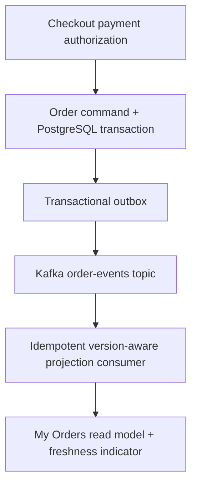

# Episode 014 — The Order Was Paid, But My Account Still Says Pending — CQRS & Eventual Consistency

**Architecture in Motion · Reconstructed edition · Original scenario, not a measured customer incident**

## Hook: the customer sees the failure first

Payment is confirmed, but My Orders still displays PENDING for several seconds or longer. Customers retry, contact support, or fear they were charged without an order.

## Request path and root cause

Checkout payment authorization → Order command + PostgreSQL transaction → Transactional outbox → Kafka order-events topic → Idempotent version-aware projection consumer → My Orders read model + freshness indicator

The payment write transaction succeeds, but a separate read-model projection lags or loses an event. A naive consumer can also overwrite a newer PAID status with an older PENDING event.

## Solution: design for correctness before speed

Commit order state and outbox event in one database transaction, publish asynchronously, consume idempotently using monotonically increasing versions, and reconcile stale projections. Show pending synchronization rather than falsely claiming payment failed.

## Trade-offs, scaling and performance

CQRS improves independent read scaling but introduces propagation delay, replay requirements, and operational complexity. Never assume Kafka delivery means exactly-once business effects.

Scale independently where justified; monitor tail latency, error budgets, retry rates, event or endpoint freshness, and business correctness. All timing illustrations are conceptual, not benchmark results.

## Failure handling and resilience

Apply explicit timeout budgets; retry only when semantics are safe; protect payment and order side effects with durable idempotency; use structured logs, traces, alerting and reconciliation.

## Security

Authenticate at gateway and service boundaries, authorize per customer/order, validate signed events where applicable, restrict infrastructure credentials, avoid PII in traces and logs, and use TLS in transit.

## Architecture diagram



## Runnable Java 21 teaching example

```java
package demo;
import java.util.*;
public class ProjectionDemo {
  record Event(String id, long version, String status) {}
  static class Projection {
    long version = -1; String status = "UNKNOWN"; Set<String> seen = new HashSet<>();
    boolean apply(Event e) {
      if (!seen.add(e.id())) return false;
      if (e.version() <= version) return false;
      version = e.version(); status = e.status(); return true;
    }
  }
  public static void main(String[] args) {
    var p = new Projection();
    p.apply(new Event("evt-paid", 2, "PAID"));
    p.apply(new Event("evt-pending", 1, "PENDING"));
    p.apply(new Event("evt-paid", 2, "PAID"));
    if (!p.status.equals("PAID") || p.version != 2) throw new AssertionError("Projection regressed");
    System.out.println("PASS: status=" + p.status + ", version=" + p.version);
  }
}
```

## PostgreSQL teaching schema

```sql
-- PostgreSQL: command state and outbox share one transaction
CREATE TABLE orders (id BIGINT PRIMARY KEY, status TEXT NOT NULL, version BIGINT NOT NULL);
CREATE TABLE outbox (event_id UUID PRIMARY KEY, order_id BIGINT NOT NULL, version BIGINT NOT NULL, event_type TEXT NOT NULL, payload JSONB NOT NULL, published_at TIMESTAMPTZ);
CREATE TABLE order_projection (order_id BIGINT PRIMARY KEY, status TEXT NOT NULL, version BIGINT NOT NULL);
BEGIN;
UPDATE orders SET status='PAID',version=version+1 WHERE id=101 AND status='PENDING';
INSERT INTO outbox(event_id,order_id,version,event_type,payload)
SELECT gen_random_uuid(),id,version,'OrderPaid',jsonb_build_object('status',status) FROM orders WHERE id=101 AND status='PAID';
COMMIT;
-- In production, ensure the UPDATE actually transitioned exactly one row and outbox publication is atomic with that transition.
-- Projection upsert only advances newer versions:
INSERT INTO order_projection(order_id,status,version) VALUES (101,'PAID',2)
ON CONFLICT (order_id) DO UPDATE SET status=EXCLUDED.status,version=EXCLUDED.version
WHERE order_projection.version < EXCLUDED.version;
```

## Step-by-step implementation

1. Capture the customer-visible failure and a correlation ID.
2. Reproduce the failing ordering/routing case.
3. Add a business correctness invariant before optimizing.
4. Make failure/retry semantics explicit.
5. Validate under fault injection, then monitor in staging.

## Pitfalls

- Treating timeouts as proof of rollback.
- Relying on in-memory locks or counters for distributed correctness.
- Omitting authorization or observability.
- Claiming performance gains without controlled measurements.

## Interview Q&A

**Q: What is the core failure?** A: The payment write transaction succeeds, but a separate read-model projection lags or loses an event. A naive consumer can also overwrite a newer PAID status with an older PENDING event.

**Q: What is the most important protection?** A: Commit order state and outbox event in one database transaction, publish asynchronously, consume idempotently using monotonically increasing versions, and reconcile stale projections. Show pending synchronization rather than falsely claiming payment failed.

**Q: What would you test?** A: Duplicate requests, process termination, delayed events, recovery, authorization, and tail latency.

## Exercises

1. Identify the incorrect transition in the simulator.
2. Add a retry/duplicate case and explain the correct outcome.
3. Design a chaos test and define a measurable acceptance criterion.

<details><summary>Exercise solution ideas</summary>Use readiness/version guards, stable idempotency keys, and assert no duplicate business side effects under retries or delayed delivery.</details>

## DEV / LinkedIn teaser

Your customer sees this: Payment is confirmed, but My Orders still displays PENDING for several seconds or longer. Customers retry, contact support, or fear they were charged without an order. The architecture problem is deeper than a spinner. In Episode 014, we trace the request, reproduce the failure, and design a recoverable fix. #Java #SpringBoot #SystemDesign #Ecommerce #BackendEngineering

## References for further verification

- Java 21 API documentation: https://docs.oracle.com/en/java/javase/21/docs/api/
- Spring Boot reference: https://docs.spring.io/spring-boot/reference/
- PostgreSQL documentation: https://www.postgresql.org/docs/current/
- Kubernetes probes: https://kubernetes.io/docs/concepts/configuration/liveness-readiness-startup-probes/
- Apache Kafka documentation: https://kafka.apache.org/documentation/
