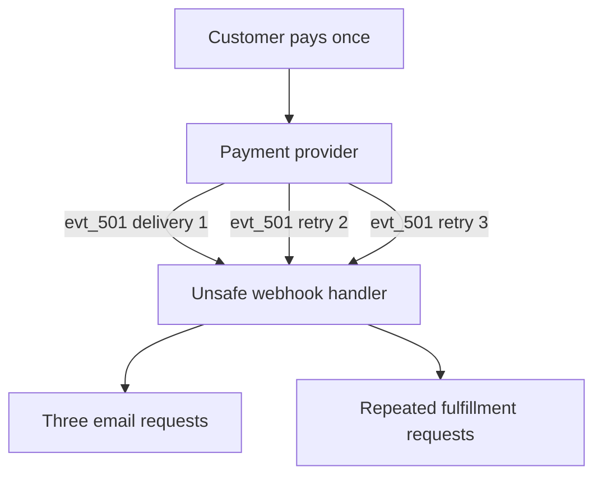
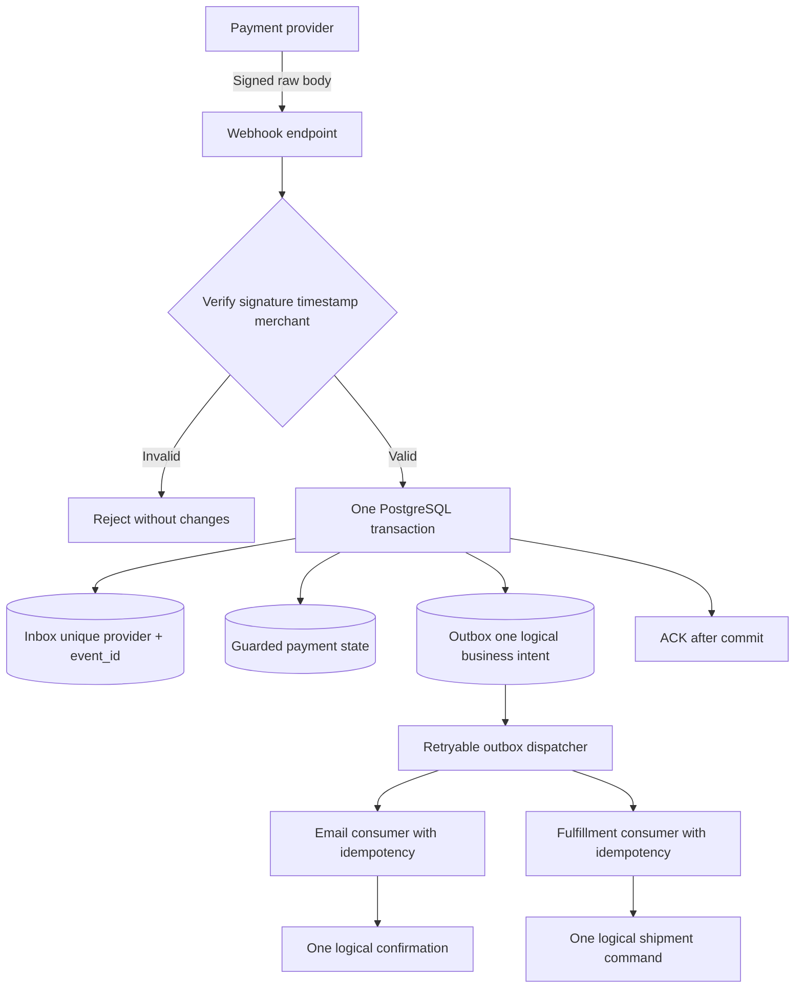

# One Payment. Three Emails. Two Shipments. Why Did Checkout Do That?

**Architecture in Motion · Episode 015 · Payment Webhook Idempotency, Inbox + Outbox**

> A customer paid once. Their bank showed one successful transaction. Then three confirmation emails arrived—and the warehouse received two requests to ship the same order. How could a successful checkout produce such a confusing result?

*Illustrative production-style incident, not a claim about a real retailer or a measured benchmark.*

## 1. Start with the customer, not the database

Meet Maya. She buys a pair of headphones for $120. Her checkout page says **Payment successful**, and her banking app shows **one** payment. One minute later she receives three emails saying **Your order is confirmed**. A warehouse integration also sees two requests to prepare the package. Maya wonders: *Was I charged three times? Will three packages arrive? Should I cancel?*

The support team must check the payment provider's actual transaction ID to answer whether any duplicate charge occurred. **Duplicate webhooks are notifications, not additional charges.** The defect is that the merchant repeatedly triggers business side effects for the same completed payment.

**Customer-visible symptoms:** repeated emails, conflicting order-status updates, duplicate fulfillment intents, increased support volume. Duplicate charges are a *different* possible defect requiring independent payment evidence.

## 2. The sequence that caused the incident

1. The provider completes payment `pay_100` and sends signed webhook `evt_501`.
2. The merchant accepts the notification, marks payment successful, and initiates an email and shipping command.
3. The merchant's HTTP acknowledgment is lost or times out **after** processing.
4. The provider cannot tell whether processing succeeded, so it sends `evt_501` again.
5. An unsafe handler repeats email and shipping side effects. It may do so a third time.
6. The customer sees repeated confirmations although the provider processed only one payment.

**Important:** The webhook does not instruct the merchant to charge the customer again. It reports an existing payment outcome.

## 3. Why the unsafe implementation fails

```java
@PostMapping("/webhooks/payments")
public ResponseEntity<Void> unsafe(@RequestBody PaymentEvent event) {
    emailClient.sendConfirmation(event.orderId());
    fulfillmentClient.createShipment(event.orderId());
    return ResponseEntity.ok().build();
}
```

Every delivery invokes both external systems. A 200 response may be lost. No durable uniqueness, signature check, payment state guard or recovery boundary exists. Worse, the network calls occur before a durable acceptance boundary.

## 4. Architecture before and after





## 5. Explain the three protections in plain English

**Inbox = the guest list.** The event has a unique identity `(provider, event_id)`. If that exact event comes back, the database knows it has already been accepted. The unique constraint works across application restarts and multiple pods. This is durable *delivery* deduplication.

**Payment state guard = the one-way turnstile.** A new event ID can still describe the same payment. Update `PENDING -> SUCCEEDED` only if the payment is currently pending; if no state change occurs, do not create another `PaymentSucceeded` business event. Never regress `REFUNDED` to `SUCCEEDED` because of a late event.

**Outbox = the reliable dispatch tray.** Save the intention to notify and fulfill in the same PostgreSQL transaction as the payment state change. A worker later dispatches it. If the worker crashes, it retries. Downstream email and warehouse systems must also deduplicate by a stable business key: the outbox alone cannot guarantee that an external provider delivers exactly once.

## 6. Step-by-step safe algorithm

1. Receive the **original raw request bytes**; enforce HTTPS, request size and rate limits.
2. Verify provider-specific signature against the raw bytes, timestamp tolerance, expected merchant/account and key rotation policy. Do this before state mutation.
3. Start a PostgreSQL transaction.
4. `INSERT ... ON CONFLICT DO NOTHING RETURNING ...` into the inbox; if already present, commit and return 2xx.
5. Guard the payment transition by payment ID and expected state. If it changes no rows, treat as already applied or a state conflict requiring reconciliation.
6. Only on a real transition, insert one unique business event into the outbox.
7. Commit. **Then** acknowledge the webhook with 2xx.
8. Outbox workers deliver with bounded retries, backoff and stable downstream idempotency keys; track acknowledgment, failures and reconciliation.

Never hold the database transaction open while calling the email, shipping or payment provider API.

## 7. Real failure paths

| Failure | Correct behavior | Customer outcome |
|---|---|---|
| ACK lost after commit | Same event ID hits inbox uniqueness; return 2xx | No new logical confirmation |
| Duplicate event with different ID | Guarded payment transition blocks second success intent | No second business transition |
| DB unavailable | Return non-2xx and rely on provider retry policy | Event eventually processed or escalated |
| Outbox worker crashes after send | Retry using same idempotency key; reconcile ambiguous delivery | Avoid repeat external side effect when provider supports dedup |
| `refunded` event arrives before `succeeded` | Verify authoritative state; do not regress terminal state | Accurate order/payment history |
| Forged webhook | Reject before mutation; alert and audit | Prevent fraudulent status updates |
| Wrong merchant or tenant | Reject / quarantine | No cross-tenant order mutation |

## 8. Why not Redis SETNX alone?

Redis TTL-based deduplication can expire, be evicted or be lost under some failure configurations, and it is not atomically committed with the PostgreSQL payment update. It can reduce duplicate load, but the authoritative unique constraint and state transition belong in durable storage.

## 9. Scale, performance and security

Keep the webhook path short: verify, persist, commit, acknowledge. Dispatch separately. Monitor webhook signature failures, duplicate rate, acknowledgment latency, outbox oldest age, worker retry count, DLQ volume and mismatched payment statuses. Use bounded concurrency, exponential backoff with jitter and retention aligned to the provider retry horizon and audit needs. Do not expose raw payment PII or secrets in logs. Verify merchant mapping and least-privilege DB credentials. Use a stable event key at *each* side-effect boundary.

This article provides no measured performance numbers. The lab uses **conceptual counters**, not throughput or latency benchmarks.

## 10. Three exercises

1. **Beginner:** Deliver `evt_501` three times. How many inbox records and `PaymentSucceeded` outbox intents exist? Answer: one each, assuming one valid payment transition.
2. **Intermediate:** Simulate a crash after commit but before the HTTP response. What happens on retry? Answer: the inbox conflict is recognized and the handler safely acknowledges without repeating the transition.
3. **Advanced:** A refund notification arrives before a delayed success notification. Design state-machine guards and provider reconciliation. Answer: verify the authoritative provider state, do not regress refunded state, and audit conflicts for manual or automated reconciliation.

## 11. Interview Q&A

**Does Kafka or a webhook provider guarantee exactly once?** No external side effect is automatically exactly-once. At-least-once delivery is common; design idempotent processing.

**Why both inbox and outbox?** Inbox protects against duplicate *input*. Outbox ensures the database transition and the *intent* to publish downstream commit together.

**Is unique `(provider,event_id)` enough?** No. Two distinct event IDs can describe the same payment; guard the business transition and downstream effects.

**When do we send HTTP 200?** After authenticating the request and durably accepting/committing it, not after performing slow external side effects.

**Does one outbox record guarantee one physical email?** No. A crash after an external send but before marking the outbox published may cause retry. Downstream idempotency is essential where supported; otherwise reconciliation/compensation is required.

## 12. The takeaway

**One payment may generate many notifications. The merchant must create one logical payment transition and one set of downstream business intents.** The inbox blocks repeated delivery, the state guard blocks repeated business transitions, and the outbox makes follow-up actions recoverable.

## Original article and references

Original page: https://www.muniprasad.in/blog/payment-webhook-idempotency-inbox-outbox

Reference topics: payment provider webhook signature/retry documentation; PostgreSQL unique constraints, transactions and `ON CONFLICT`; transactional outbox and idempotent consumers. Confirm provider-specific signature formats and retry behavior against the actual integration before production deployment.
