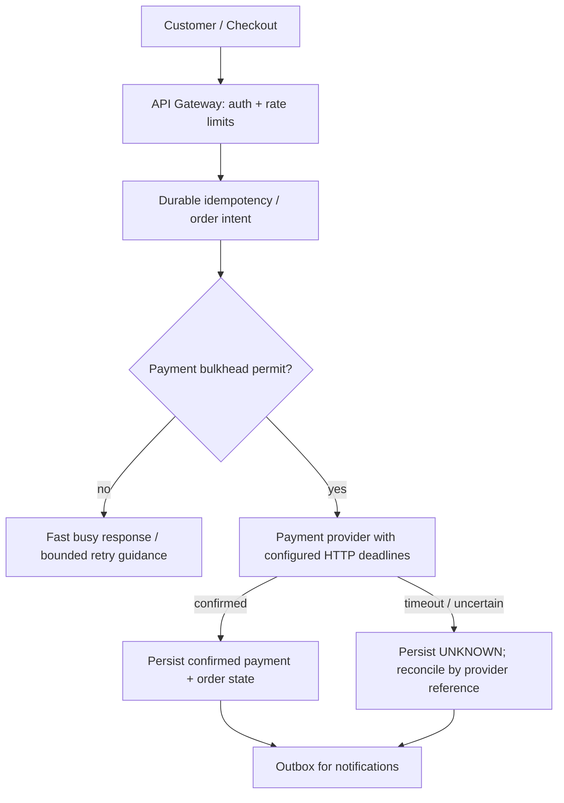

# Java 21 Virtual Threads: Checkout Is Still Spinning — Why?

**Architecture in Motion · Episode 016 | Customer-first revision**

*Illustrative incident, not a measured customer outage.*

## 1. The customer sees the failure
During a busy sale, Asha taps **Place Order**. The spinner remains for 20 seconds, then the page says **Something went wrong**. Her bank may have authorized payment, but she cannot see an order confirmation. She presses the button again. A good system must not create another payment attempt just because the browser retried.

**What the customer needs:** a quick, accurate response, a trustworthy pending state if the outcome is unknown, and no duplicate charge or order.

## 2. The backend request path
`Browser → Gateway → Spring Boot Checkout → PostgreSQL → Payment Provider`.

A conventional platform thread waits while a remote provider responds. Java 21 virtual threads make that waiting cheaper. **They do not create more payment-provider capacity or database connections.** If 500 requests reach a payment provider that can safely handle 20 at once, unbounded concurrency simply moves the queue downstream.

## 3. Wrong approach
```java
try (var executor = Executors.newVirtualThreadPerTaskExecutor()) {
  for (CheckoutRequest request : burst) {
    executor.submit(() -> paymentProvider.authorize(request));
  }
}
```
This spawns cheap waiting tasks, but has no admission control, no durable idempotency, no provider timeout, and no reconciliation. `executor.close()` also waits for submitted tasks.

## 4. Safe architecture


**Step 1 — Persist a durable operation identity.** Generate a stable payment attempt reference and scope the request's idempotency key to customer and operation. Reject reuse of the same key with a different payload. Use a database uniqueness constraint; a JVM-local lock is not sufficient across replicas.

**Step 2 — Bound downstream concurrency.** Apply a semaphore or bulkhead to provider calls, ideally at the shared dependency boundary. A per-pod limit is not a global provider limit: combine with global quotas or coordinate capacity across replicas when necessary. Return 503/429 with appropriate retry guidance for work not yet accepted; don't mislabel an already-started payment as safe to retry.

**Step 3 — Configure real network deadlines.** Set connect and response timeouts on the HTTP client, plus an end-to-end checkout deadline. `Future.get(timeout)` stops waiting; it does not guarantee that a remote payment was canceled.

**Step 4 — Reconcile uncertainty.** On ambiguous provider outcomes, persist `UNKNOWN` and query the provider by the original stable reference. Do not initiate another capture until status is known. Show the customer **We're checking your payment** with an order reference.

**Step 5 — Make side effects durable.** Use a transactional outbox for confirmation/fulfillment events and idempotent downstream consumers.

## 5. Trade-offs and performance
Virtual threads improve the efficiency of blocking I/O concurrency; they do not speed up the provider or increase a 20-connection HikariCP pool. Bulkheads protect downstream resources but may reject traffic during peaks. Queueing adds latency, so keep queues bounded. A fairness-enabled semaphore can reduce starvation but adds overhead. Monitor active permits, rejection rate, Hikari pending connections, provider errors, queue wait, and p95/p99 latency. In Java 21, blocking while holding `synchronized` can pin carriers; inspect JFR `jdk.VirtualThreadPinned`. Don't claim performance gains without repeatable load tests.

## 6. Security and failure modes
Validate authenticated ownership of the order; never trust client-supplied customer IDs. Do not log card data, credentials, or sensitive provider payloads. Apply provider signature verification for asynchronous callbacks. Simulate slow provider, duplicate request, pool exhaustion, crash after authorization, and process restart before releasing a pending operation. A semaphore alone is neither an idempotency mechanism nor a distributed capacity governor.

## 7. How to validate
Use a provider stub with controllable delay and failures; run identical traffic against platform-thread and virtual-thread modes with the same hardware and pool settings. Record throughput, p50/p95/p99, DB connection wait, provider concurrency, rejected requests and duplicate payment attempts. No timing values in this lesson are measured benchmarks.

## 8. Interview questions
**Do virtual threads make each HTTP call faster?** No. They make blocking waiting less expensive.

**Why is a bulkhead needed?** It caps work sent to a scarce dependency and isolates failures.

**What if the payment times out after the provider accepted it?** Persist an unknown state and reconcile by original payment reference before retrying.

**Does a per-instance semaphore protect a provider globally?** No. Multiple replicas multiply the allowed concurrent calls.

**Can a virtual thread be pinned?** In Java 21, yes; blocking while holding a monitor is a relevant case.

## 9. Exercises
1. Explain why 500 virtual threads cannot execute 500 simultaneous SQL queries with 20 pooled connections.
2. Add a 100 ms permit wait and a customer-safe rejection response. Ensure permits release in `finally`.
3. Design a durable `UNKNOWN → CONFIRMED / FAILED` reconciliation workflow that survives a restart.

## 10. Takeaway
**Cheaper threads are not extra capacity. Protect the dependency, preserve payment identity, and tell customers the truth about uncertain outcomes.**
