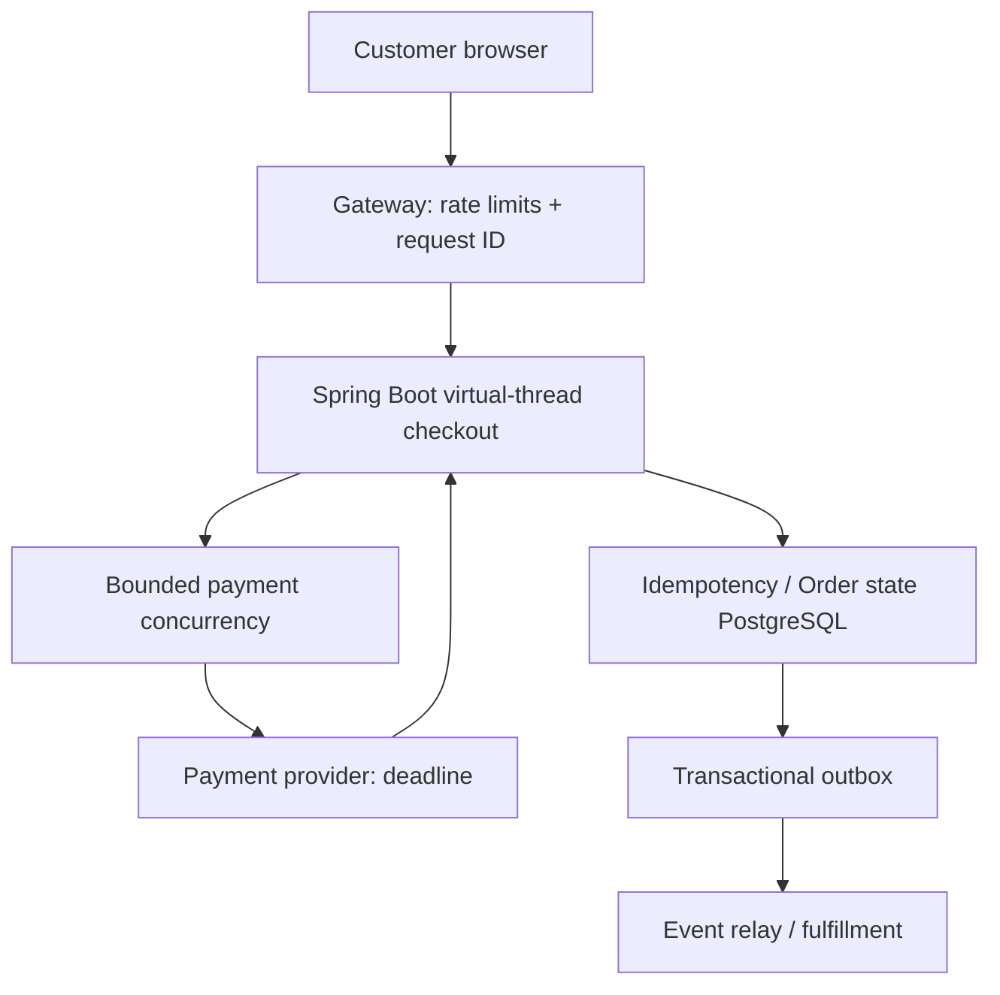

# Episode 016 — Virtual Threads Are Not a Faster Database: Fixing Checkout Queueing in Java 21

> A faster-looking thread model cannot rescue an overloaded payment provider. The customer needs a reliable checkout, not just a different Java API.

## What the customer actually sees
A shopper taps **Place Order** during a flash sale. The button spins, then shows a timeout. The shopper tries again. If the server lacks durable idempotency, two order attempts may be created. The illustration is a realistic engineering scenario, not a report of a measured incident.

## The real technical problem
The request path is **Browser → API Gateway → Spring Boot Checkout → PostgreSQL → Payment Provider**. In a traditional thread-per-request server, a platform thread can remain occupied while waiting for a remote HTTP response. A bounded worker pool can queue incoming requests. Java 21 virtual threads make blocking I/O concurrency cheaper, but do not make external systems faster.

## Architecture: what changes


### Step 1: Adopt virtual threads only where they fit
Java 21's `Executors.newVirtualThreadPerTaskExecutor()` is suitable for independent blocking tasks. Spring Boot supports `spring.threads.virtual.enabled=true` when running on Java 21+ (subject to server/runtime compatibility). Do not assume this switches every library or every internal executor.

### Step 2: Preserve business correctness
The checkout API requires an idempotency key scoped to customer and operation, persisted with a unique constraint. The server must return the existing result for repeated identical requests and reject reuse with a different payload. Reserve an order state before calling a payment provider; recover ambiguous timeouts by querying provider status rather than blindly charging again.

### Step 3: Bound the real bottleneck
Use a semaphore or bulkhead to cap concurrent calls to a provider. Use connect/read deadlines and bounded retries only for safe operations. A semaphore permit must be released in `finally`; the limit is an example to tune against actual capacity.

### Step 4: Monitor the bottleneck you moved
Collect gateway queue time, active downstream calls, HikariCP pending connection count, p95/p99 latency, provider error rates, idempotency conflict rate and CPU. Compare identical traffic profiles with and without virtual threads. Virtual threads may improve concurrency under I/O waiting; they do not guarantee a latency improvement.

## Minimal Java 21 example
```java
import java.time.Duration;
import java.util.concurrent.*;

public final class PaymentBulkhead implements AutoCloseable {
  private final Semaphore permits = new Semaphore(40, true);
  private final ExecutorService executor = Executors.newVirtualThreadPerTaskExecutor();
  public <T> Future<T> submit(Callable<T> paymentCall) {
    return executor.submit(() -> {
      if (!permits.tryAcquire(200, TimeUnit.MILLISECONDS))
        throw new RejectedExecutionException("Payment capacity reached");
      try { return paymentCall.call(); }
      finally { permits.release(); }
    });
  }
  @Override public void close() { executor.close(); }
}
```
The example demonstrates admission control, **not** payment idempotency, cancellation, or a production-ready checkout endpoint. For HTTP timeouts, configure the underlying client explicitly; `Future.get(timeout)` alone does not reliably stop an in-flight network request.

### Spring Boot configuration
```yaml
spring:
  threads:
    virtual:
      enabled: true
  datasource:
    hikari:
      maximum-pool-size: 20
```
The pool value is illustrative; use measurements to size it. For Java 21 synchronized blocks can pin a virtual thread to its carrier while blocking; inspect JFR `jdk.VirtualThreadPinned` events and test native/blocking libraries. Later JDK behavior differs, so avoid version-general claims.

## Failure modes and trade-offs
* **Payment provider slow:** threads become cheaper, but provider queues still grow. Apply admission control and customer-friendly retry guidance.
* **Database pool exhausted:** virtual threads simply wait for scarce connections; keep transactions short and monitor pool wait.
* **Timeout after provider accepted charge:** reconcile by payment reference and idempotency key before retrying.
* **CPU-heavy work:** virtual threads do not accelerate CPU; use bounded computation pools.
* **Security:** authenticate customer ownership, redact payment data, protect idempotency keys from cross-user reuse, and avoid logging secrets.

## How to validate
Use a repeatable test with the same traffic, database pool, provider simulator delay and hardware. Capture latency distributions and saturation metrics. **No throughput or latency numbers in this article are benchmark claims.** Run chaos tests for slow provider, connection pool starvation, duplicate requests and process crash after payment acknowledgment.

## Interview Q&A
**Do virtual threads make requests faster?** Not necessarily; they reduce the cost of waiting on blocking I/O, enabling higher concurrency when another bottleneck does not dominate.

**Should every request create unlimited virtual threads?** No. Bound expensive downstream resources even if virtual threads are inexpensive.

**Can virtual threads prevent duplicate charges?** No. Use durable idempotency and payment reconciliation.

**What is pinning?** A virtual thread can hold its carrier while blocked in certain operations; monitor JFR and library behavior for the target JDK.

## Exercises
1. Explain why 500 virtual threads do not allow 500 simultaneous queries with a 20-connection pool.
2. Add a safe `Retry-After` response when the payment bulkhead is full.
3. Design a crash-recovery state machine for a provider timeout after authorization.

## Takeaway
Virtual threads are a concurrency tool. The customer-facing solution combines efficient waiting with strict downstream limits, idempotency, observable timeouts, and recovery.
