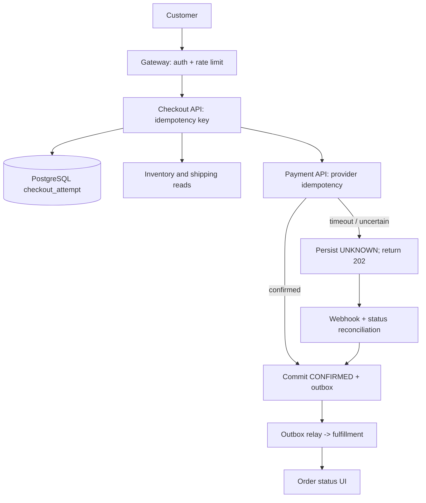

# Episode 020 — The Checkout That Timed Out but Still Charged the Card

**Java 21 CompletableFuture, cancellation, deadlines and checkout failure propagation**

*Architecture in Motion · Java/JVM phase · Original educational scenario · Not a real customer incident*

## The customer-facing failure
A shopper presses **Place Order**. Inventory reservation returns in 80 ms, but the payment gateway takes six seconds. The checkout API gives up after two seconds and displays “Payment failed—try again.” The shopper retries. Meanwhile the first payment request may still be executing, creating an ambiguous outcome and possible duplicate authorization if idempotency is missing. A timeout is not a rollback.

## The underlying failure
A common implementation uses `CompletableFuture.supplyAsync()` for inventory, pricing and payment, then `allOf(...).join()`. There are three traps: (1) the default common pool is a shared resource; blocking HTTP calls can starve unrelated work, (2) `orTimeout()` completes the *future* exceptionally but does not reliably interrupt or cancel the underlying network call, and (3) sibling work can continue after one branch fails. `CompletableFuture.cancel(true)` likewise does not guarantee interruption of its running computation. A client disconnect does not reverse a payment.

## End-to-end architecture
1. The API gateway authenticates, rate-limits, attaches a trace ID, and accepts an **Idempotency-Key** scoped to the authenticated customer and purchase intent.
2. The checkout service validates cart, price and stock, then creates a durable checkout attempt with a unique idempotency key and a state machine (`NEW`, `PAYMENT_PENDING`, `CONFIRMED`, `FAILED`, `UNKNOWN`).
3. Read-only inventory and shipping estimates may run concurrently with a bounded executor and explicit deadlines. Never parallelize irreversible side effects blindly.
4. Before invoking the payment provider, persist an attempt ID and pass a stable provider idempotency key. Use configured HTTP connection/read/request timeouts.
5. If the provider times out, mark the attempt `UNKNOWN` or `PAYMENT_PENDING`, **not** `FAILED`; return `202 Accepted` with a status URL. Reconcile via signed webhook and provider status lookup.
6. A transactionally written outbox event initiates fulfillment only after confirmed payment. A unique constraint and idempotent consumer prevent duplicate fulfillment. Refund/void is an explicit compensating action, not a Java exception handler.



## Java 21 code: safe read-only fan-out
The following JDK-only example runs on Java 21. It illustrates deadline handling, not payment authorization. Java 21's `StructuredTaskScope` is a preview API; this lesson uses standard `CompletableFuture` instead. Spring Boot should manage a dedicated bounded executor, rather than relying on `ForkJoinPool.commonPool()` for blocking I/O.

```java
import java.time.Duration;
import java.util.concurrent.*;

public class CheckoutReadFanout {
  record Quote(int stock, int shippingCents) {}
  static Quote quote(Executor executor) throws Exception {
    CompletableFuture<Integer> stock = CompletableFuture.supplyAsync(() -> 4, executor);
    CompletableFuture<Integer> shipping = CompletableFuture.supplyAsync(() -> 799, executor);
    try {
      return stock.thenCombine(shipping, Quote::new).get(500, TimeUnit.MILLISECONDS);
    } catch (TimeoutException ex) {
      stock.cancel(true); shipping.cancel(true); // best effort, NOT guaranteed interruption
      throw ex;
    }
  }
  public static void main(String[] args) throws Exception {
    ExecutorService pool = Executors.newFixedThreadPool(4);
    try { System.out.println(quote(pool)); } finally { pool.shutdownNow(); }
  }
}
```

**Spring Boot design sketch:** Configure `ThreadPoolTaskExecutor` with explicit core/max sizes, queue capacity, rejection policy and shutdown behavior. Inject the executor into the quote service. Use a payment client with HTTP deadlines, a durable `checkout_attempt` table, and a provider-specific idempotency key. Map uncertain outcomes to 202, not a misleading failure. Do not send raw card details to application logs or tracing.

## Database schema (PostgreSQL)
```sql
CREATE TABLE checkout_attempt (
 id BIGINT GENERATED ALWAYS AS IDENTITY PRIMARY KEY,
 customer_id BIGINT NOT NULL,
 idempotency_key TEXT NOT NULL,
 provider_reference TEXT,
 state TEXT NOT NULL CHECK (state IN ('NEW','PAYMENT_PENDING','UNKNOWN','CONFIRMED','FAILED')),
 created_at TIMESTAMPTZ NOT NULL DEFAULT now(),
 UNIQUE (customer_id,idempotency_key)
);
CREATE TABLE checkout_outbox (
 event_id UUID PRIMARY KEY,
 attempt_id BIGINT NOT NULL REFERENCES checkout_attempt(id),
 event_type TEXT NOT NULL,
 payload JSONB NOT NULL,
 published_at TIMESTAMPTZ
);
```

## Failure-mode and trade-off review
**Deadline vs cancellation:** A future timeout is an observation; it does not cancel the external side effect. Configure transport timeouts and provider-side idempotency. **Thread pools vs virtual threads:** Virtual threads can improve blocking-I/O concurrency, but do not expand database or provider capacity; bound downstream concurrency. **Fast fail vs reconciliation:** Returning `202` is less immediately satisfying but avoids telling the customer an unknown payment definitely failed. **Retries:** Retry only when safe, with stable keys, exponential backoff and jitter; cap attempts. **Security:** Verify signed webhooks against raw request bytes, use least-privilege credentials, avoid logging PII and card data. **Scaling:** Partition reconciliation jobs and index `state,created_at`; observe age of UNKNOWN attempts, payment reconciliation time, queue saturation and p95/p99 checkout latency.

## Validation plan (not executed against a real provider)
Use a fake payment server to simulate success, 6-second delay, connection reset and duplicate webhook. Assert one payment intent per idempotency key; an uncertain timeout yields 202; reconciliation converges to CONFIRMED or FAILED; fulfillment emits once; logs exclude sensitive payment fields. Repeat under load and collect actual latency and error rates before claiming performance improvements.

## Three exercises
1. **Beginner:** Explain why `orTimeout` cannot guarantee that a charge was canceled.
2. **Intermediate:** Add a bounded executor and a 500 ms quote deadline; distinguish rejected work from timeout.
3. **Senior:** Implement a durable state machine and reconciliation worker with a provider idempotency key and an outbox. Prove duplicate webhook delivery does not duplicate fulfillment.

<details><summary>Exercise solutions</summary>
1. It completes the future exceptionally; the HTTP request may still be in flight. 2. Use a dedicated bounded executor, catch `RejectedExecutionException` and `TimeoutException` separately, and apply transport deadlines. 3. Use a unique `(customer_id,idempotency_key)`, conditional state transitions, an outbox committed with the state change, and a deduplicating fulfillment consumer.
</details>

## Interview questions
**Q: Does `CompletableFuture.cancel(true)` interrupt an active supplier?** Not reliably; cancellation is not a remote side-effect rollback. **Q: Should payment be inside `allOf` with stock and shipping?** Usually no: isolate irreversible payment actions behind durable state and idempotency. **Q: Why return 202?** Because an ambiguous remote timeout cannot be represented truthfully as payment failure. **Q: What changes with Java 21 virtual threads?** Blocking waits become cheaper, but downstream capacity and business semantics remain unchanged.

## Architecture decision
Use concurrency for independent read-only work; use durable orchestration for money-moving side effects. The goal is not the shortest checkout code. It is a checkout that tells the truth when networks fail.

*Illustrations and lab are conceptual; no real performance benchmarks were conducted.*
